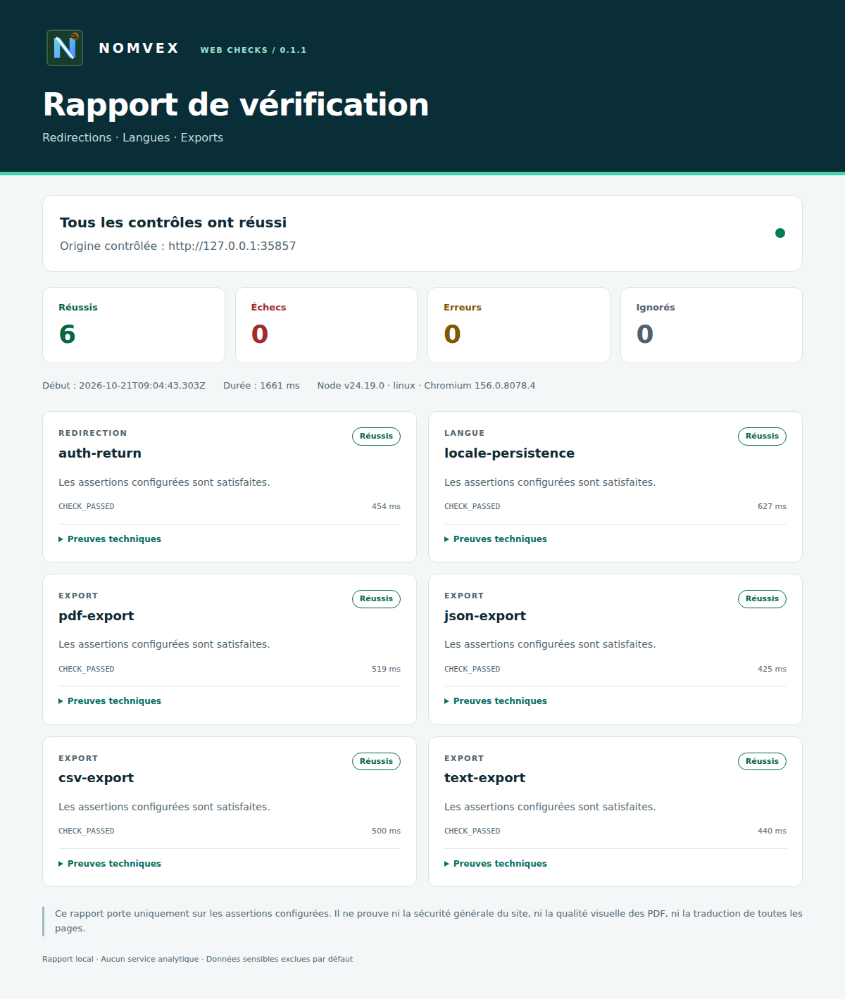

<p></p>

# NOMVEX Toolbox — Web Checks

[English](README.en.md) · [Configuration](docs/CONFIGURATION.md) · [Catalogue](catalog/README.md) · [Contribuer](CONTRIBUTING.md)

**Vérifier des redirections, la persistance d’une langue et des téléchargements, puis obtenir un rapport lisible et un résultat exploitable en CI.**

Web Checks est le premier outil original de NOMVEX Toolbox. Il utilise une configuration JSON et Playwright pour exécuter des parcours explicites. La démonstration utilise un petit site local avec un comportement correct et des erreurs volontairement introduites. Aucun compte NOMVEX ni clé d’API payante n’est nécessaire pour cette démonstration.



[Rapport HTML français](docs/examples/healthy-report.fr.html) · [English HTML report](docs/examples/healthy-report.en.html) · [Preuves de vérification](docs/ACCEPTANCE.md)

## Commencer dans cette copie du projet

Ouvrez un terminal dans le dossier qui contient `package.json`. Utilisez une version de Node compatible avec le champ `engines` de ce fichier.

```bash
npm ci
npx playwright install chromium
npm run build
npm test
npm run demo
```

L’installation des paquets et du navigateur nécessite un accès réseau. Selon la machine, Chromium peut aussi nécessiter des bibliothèques système : consultez les instructions de Playwright si son lancement échoue. Le test local ne nécessite pas de service de modèle d’IA.

Pour voir la détection des erreurs préparées dans le site de démonstration :

```bash
npm run demo:broken
```

Ce scénario doit montrer des contrôles en échec et renvoyer le code **1**. Un échec attendu dans cette démonstration n’est pas une preuve de panne de vos sites. Le site local est lancé et arrêté par la commande de démonstration ; le chemin du rapport est affiché dans le terminal.

Pour vérifier la structure du catalogue :

```bash
npm run catalog -- --query pdf --lang fr
npm run catalog:check
```

Ces commandes exécutent le code local. Elles ne supposent pas une publication du paquet sur npm.

## Vérifier votre environnement de test

Adaptez [examples/config.json](examples/config.json) à un environnement que vous êtes autorisé à contrôler. Les sélecteurs et les résultats attendus dépendent de votre application ; ils ne sont pas découverts automatiquement.

```bash
npm run check -- --config examples/config.json --out reports --lang fr
```

Le dossier de sortie contient `report.json` et `report.html`. Ouvrez le fichier HTML dans votre navigateur. Utilisez `--lang en` pour un rapport anglais. La langue par défaut est le français. Les rapports existants ne sont pas écrasés : choisissez un nouveau dossier `--out` à chaque exécution, ou omettez cette option pour obtenir un sous-dossier daté automatiquement.

| Contrôle | Ce qui est vérifié | Limite à connaître |
| --- | --- | --- |
| `redirect` | Le chemin atteint après les actions prévues | Un contrôle du chemin ne valide pas toute la politique d’authentification |
| `locale` | La langue déclarée et, si configuré, un texte après rechargement ou navigation | Ce contrôle ne vérifie pas toutes les traductions ni leur qualité |
| `download` | La réception et des propriétés du fichier PDF, JSON, CSV ou texte | La validation structurelle ne prouve pas l’exactitude métier ni le rendu visuel |

Les étapes JSON permettent de cliquer, remplir et sélectionner des champs. Elles peuvent donc avoir des effets dans l’application cible. Utilisez des comptes et données de test. Pour les secrets, utilisez les références aux variables d’environnement décrites dans [la configuration](docs/CONFIGURATION.md).

### Interpréter le résultat

| État | Signification |
| --- | --- |
| `passed` | Les assertions configurées ont réussi pendant cette exécution |
| `failed` | Le comportement observé ne correspond pas à une assertion |
| `error` | Une erreur de configuration, d’exécution ou de dépendance a empêché le contrôle |
| `skipped` | Le contrôle n’a pas été exécuté ; il ne compte pas comme une réussite |

Codes de sortie : **0** si tous les contrôles ont réussi ; **1** en cas d’échec fonctionnel ; **2** pour une erreur ou une exécution incomplète, y compris un contrôle ignoré. Une combinaison d’échec et d’erreur renvoie **2**.

## Ce que contient le catalogue

[24 fiches](catalog/README.md) présentent des bibliothèques et outils dont les sources primaires ont été consultées. Chaque fiche initiale porte le statut `source-reviewed` et `evidence.test: null`. Cela ne signifie pas que ces 24 outils ont été installés, testés ou intégrés dans NOMVEX.

Les dépendances exécutées par Web Checks sont déterminées par `package.json` et `package-lock.json`. Les résultats d’une exécution de Web Checks ne qualifient pas automatiquement tous les usages possibles de ces dépendances.

## Périmètre et preuves

- Le scénario local montre le fonctionnement du vérificateur sur ses fixtures.
- Une vérification sur les vrais sites NOMVEX demande une configuration et un résultat propres à ces sites.
- La prise en charge annoncée d’un système par une dépendance ne constitue pas un test de ce projet sur ce système. Windows et macOS restent non vérifiés tant qu’un rapport de cette version n’est pas disponible.
- Les rapports peuvent révéler des URL ou du contexte de test. Vérifiez-les avant de les partager.
- Le projet ne promet ni nombre d’étoiles, ni adoption, ni absence totale de défauts.

## Participer et réutiliser

Une correction reproductible, une amélioration d’accessibilité ou une traduction utile est bienvenue. Consultez [CONTRIBUTING.md](CONTRIBUTING.md), [SECURITY.md](SECURITY.md) et [le code de conduite](CODE_OF_CONDUCT.md).

Le code original est distribué sous [Apache-2.0](LICENSE), avec les attributions du fichier [NOTICE](NOTICE). Les outils référencés et les dépendances conservent leurs licences. [Les règles du catalogue](docs/CATALOG.md) et [les notes de licence](docs/LICENSES.md) expliquent la distinction.

Si l’outil vous est utile, une étoile est appréciée. Son utilisation et ses fonctions ne sont pas conditionnées à une étoile, à un abonnement ou à un compte NOMVEX.
